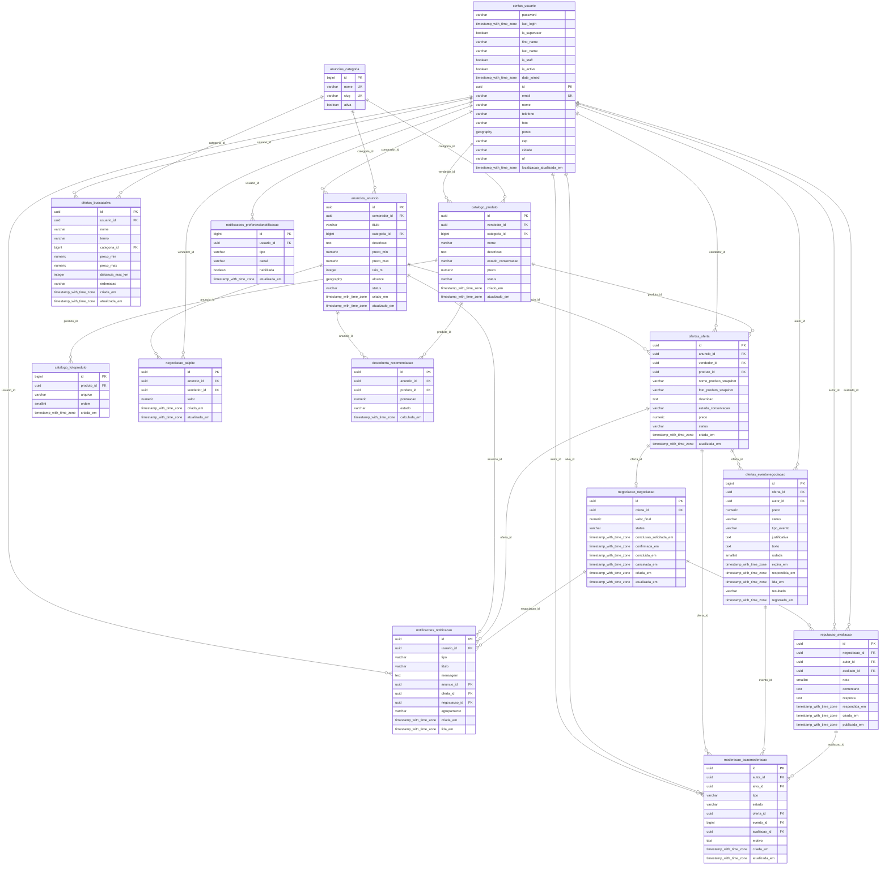

# Modelo físico do banco

Banco: **PostgreSQL 16 + PostGIS 3.4**. O DDL completo das tabelas da aplicação (colunas, tipos, chaves, índices, `CHECK` e chaves estrangeiras) está em [`schema.sql`](schema.sql), gerado a partir do banco após aplicar todas as migrations.

## Diagrama entidade-relacionamento

Tabelas próprias da aplicação. As tabelas internas do Django (`auth_*`, `django_*`, `token_blacklist_*`) e as tabelas de junção `contas_usuario_groups` e `contas_usuario_user_permissions` não aparecem no diagrama.



## Tabelas

| Tabela | Conteúdo |
| --- | --- |
| `contas_usuario` | Usuário (login por e-mail) e localização de referência (`ponto` em `geography`) |
| `anuncios_categoria` | Catálogo de categorias |
| `anuncios_anuncio` | Anúncio de procura do comprador; `alcance` materializa o raio para indexação GiST |
| `ofertas_oferta` | Oferta de um vendedor para um anúncio |
| `ofertas_eventonegociacao` | Histórico de preço, contrapropostas e mensagens de uma oferta |
| `ofertas_buscasalva` | Filtros de busca salvos pelo usuário |
| `catalogo_produto` / `catalogo_fotoproduto` | Catálogo do vendedor e suas fotos |
| `negociacao_negociacao` | Negociação aberta a partir de uma oferta aceita (1:1) |
| `negociacao_palpite` | Palpite de preço de um vendedor sobre um anúncio |
| `descoberta_recomendacao` | Recomendação de produto para anúncio |
| `notificacoes_notificacao` / `notificacoes_preferencianotificacao` | Notificações e preferências por usuário |
| `reputacao_avaliacao` | Avaliação entre as partes após a negociação |
| `moderacao_acaomoderacao` | Denúncias e ações de moderação |

## Índices espaciais

- `contas_usuario.ponto` — GiST
- `anuncios_anuncio.alcance` — GiST

## Regenerar

Com os containers em execução:

```sh
docker compose exec -T db sh -c 'pg_dump -U quero -d quero --schema-only --no-owner --no-privileges $(for p in contas anuncios catalogo descoberta moderacao negociacao notificacoes ofertas reputacao; do printf -- "-t public.%s_* " $p; done)' | sed '/^\\restrict /d;/^\\unrestrict /d' > docs/schema.sql
```
